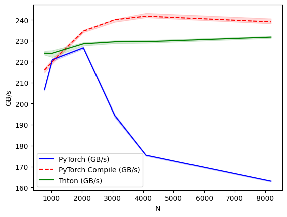

# Custom GPU Compute Kernels for LLM Inference 🚀

Fused SiLU and LayerNorm kernels implemented in OpenAI Triton, benchmarked against eager PyTorch and `torch.compile` on an NVIDIA T4 GPU.

## 1. Key Results

| Hidden Dim (N) | PyTorch Eager (GB/s) | torch.compile (GB/s) | Triton Kernel (GB/s) | Triton vs Eager |
|----------------|----------------------|----------------------|----------------------|-----------------|
| 768            | 206.03               | 159.17               | **224.62**           | ~1.09x          |
| 1024           | 220.57               | 204.49               | **224.49**           | ~1.01x          |
| 2048           | 226.60               | 221.03               | **225.40**           | Parity          |
| 3072           | 193.80               | 221.99               | **225.99**           | ~1.16x          |
| 4096           | 175.37               | 223.41               | **226.35**           | ~1.29x          |
| 8192           | 163.22               | 172.01               | **229.34**           | ~1.40x          |

**Conclusion:** The custom Triton kernel achieves performance parity with highly optimized eager PyTorch for smaller dimensions ($N \le 2048$). However, for larger dimensions typical of modern LLMs ($N \ge 3072$), Triton outperforms eager PyTorch by 1.2x - 1.4x, remaining within ~5% of the performance of a static `torch.compile` graph.

## 2. Method
* **Effective Bandwidth:** Calculated using the theoretical minimum data transfer required to solve the operation: `2 * M * N * bytes_per_element / execution_time`. This measures algorithmic effective bandwidth, not the actual hardware bytes moved.
* **Benchmarking:** Utilized `triton.testing.do_bench` for accurate timing (which handles warmup and `torch.cuda.synchronize()`). 
* **Parameters:** Benchmarks were run using FP16 precision (standard for inference) with a fixed batch/sequence size of $M = 4096$. 
* `torch.compile` was initialized outside the benchmarking loop with `dynamic=False` to prevent recompilation overhead skewing the results across different $N$ shapes.

## 3. Profiler Finding & Hypothesis Verification
The initial hypothesis assumed that eager PyTorch executes multiple kernels during the LayerNorm forward pass (e.g., storing intermediate statistics for backpropagation), which would explain the bandwidth drop. 

To verify this, the PyTorch CUDA profiler was used. **The profiler disproved this hypothesis**, showing that eager PyTorch actually dispatches a single highly-optimized kernel (`vectorized_layer_norm_kernel`) for the forward pass. The ability to verify and correct hardware assumptions via profiling is a core takeaway of this experiment.

## 4. Correctness Testing
Before benchmarking, the kernels were rigorously tested using `torch.testing.assert_close`:
* **Shapes:** Tested on both power-of-two and irregular shapes (e.g., $N=1000, 3072$) to ensure the masking logic handles padding correctly without segfaults.
* **Precision:** Tested in both FP32 (`atol=1e-4`, `rtol=1e-4`) and FP16 (`atol=1e-2`, `rtol=1e-2`).
* **Inputs:** Weight ($\gamma$) and Bias ($\beta$) initialized as random tensors rather than ones/zeros to prevent masking algebraic errors.

## 5. Limitations
* **Hardware:** Benchmarked on a single NVIDIA T4 (Turing architecture). Memory wall gaps may behave differently on Ampere/Hopper architectures.
* **Scope:** Only the forward pass (inference) was implemented.
* **Fixed Token Count:** $M$ was fixed at 4096; varying sequence lengths were not profiled.
* **Root Cause Unresolved:** While the profiler proved PyTorch uses a single kernel, the exact cause of the eager implementation's degradation at large $N$ requires further PTX/SASS inspection.

## 6. Environment & Reproduction
* **PyTorch Version:** 2.1.0+ (CUDA 12)
* **Triton Version:** 3.6.0
* **Hardware:** NVIDIA T4

[

## 7. Next Steps
* Implement `@triton.autotune` to dynamically select the optimal `num_warps` and `BLOCK_SIZE`.
* Extend the kernel to compute the backward pass for training optimization.
* Inspect `torch.compile` (TorchInductor) generated code to compare its memory access patterns against the custom Triton kernel.
* Implement **RMSNorm** (Root Mean Square Normalization), the standard variant used in LLaMA architecture.
